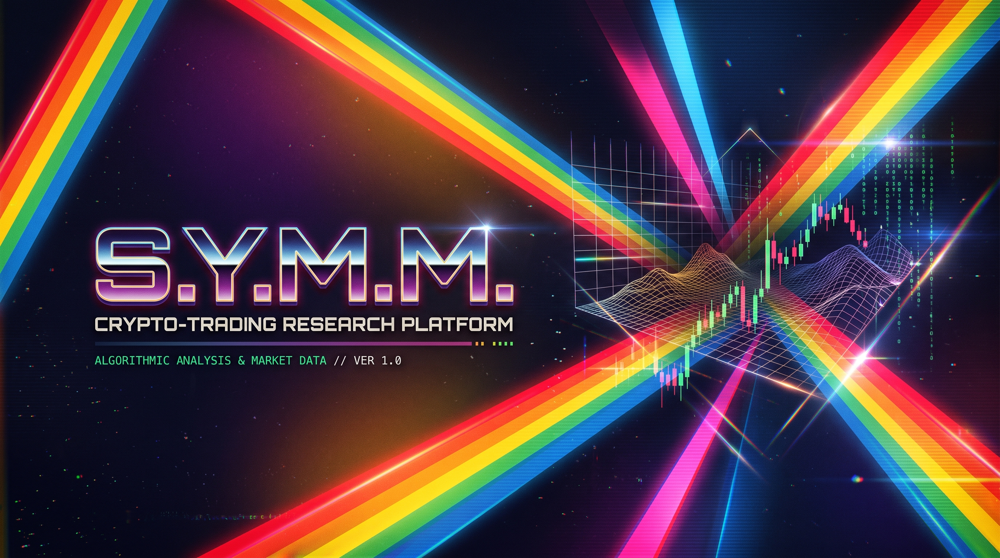

# S.Y.M.M. — Shake Your Money Maker

**A personal research project about whether a machine can learn to trade a crypto
market by measuring its own results — and prove, afterwards, that it was thinking
straight when it did.**

S.Y.M.M. connects to Kraken (public trades, authenticated private channel, and
Level 3 order books), turns each market moment into typed numerical measurements,
projects those measurements into a shared **confluence grid**, compresses live
regimes into **Sequitur token paths**, and matches those paths against policies
stored in object storage. Authorized **enter** and **exit** actions go through
**`broker.Desk`**, which sizes from the book, tracks fills, and persists open and
closed lots. Every aggregate workspace tick is a **`data.Value`** whose layers hold
the full pipeline state; the process **`io.Copy`**s that value to SeaweedFS (S3)
and the dashboard hub replays the latest frame on connect.

> ### ⚠️ Read this first
>
> - **This is a personal project.** It is my own experiment, built for my own curiosity.
>   It is not a product, not a service, and comes with no support, no roadmap, and no
>   stability promises. **It may change completely, or be abandoned, at any moment.**
> - **This is not financial advice.** Nothing here is a recommendation to buy, sell, or
>   hold anything. Nothing here is investment, tax, or legal advice.
> - **No guarantee of any kind.** There is no claim, implied or otherwise, that this
>   system is or will be profitable. The evidence so far is that markets are hard and
>   fees are relentless. Most of this code exists to *measure* whether an edge is real,
>   precisely because assuming one is the most expensive mistake available.
> - **Simulation is not proof.** Paper fills and virtual ledger samples are forward
>   observations under a stated execution model. They are not exchange profitability,
>   and their totals are records of what the learner realized — never a balance anyone
>   holds.
> - **Trading real funds risks losing them.** Pointing experimental software at a live
>   Kraken account is entirely at your own risk.
> - Software provided **as is**, without warranty of any kind.

## Contents

- [Overview](#overview)
- [Architecture](#architecture)
- [Runtime data flow](#runtime-data-flow)
- [Signals and the grid](#signals-and-the-grid)
- [Solvers and parallel experiment](#solvers-and-parallel-experiment)
- [Learning and execution](#learning-and-execution)
- [Storage and Hindsight](#storage-and-hindsight)
- [Nomagique](#nomagique)
- [Dashboard](#dashboard)
- [Configuration](#configuration)
- [Build and run](#build-and-run)
- [Tests and benchmarks](#tests-and-benchmarks)
- [Repository map](#repository-map)
- [Design references](#design-references)

## Overview

The live process runs one **LMAX-style pipeline** per aggregate trade tick:

1. **Ten signal handlers** append measurement layers to a shared `data.Value`.
2. **`strategy.Training`** observes the grid, emits region tokens, runs per-symbol
   **Sequitur** grammars, and drives **`strategy.Model`** (prefix-tree policies,
   virtual excursions, and venue entries through the desk).
3. **Sinks** persist the tick (`store.Client` → S3) and stream it (`ui.Hub` → WebSocket).

Venue lots open and close only through **`Model` → `Desk`**.

Stored tape supports offline **detect** (excursion labels), **train** (policy
`enter.bin` / `exit.bin` from detections), and **audit** (metric health on active
symbols). Those flows share the same S3 prefixes and [`SIGNALS.md`](SIGNALS.md)
contract; details are in [`AGENTS.md`](AGENTS.md).

## Architecture

```text
     Kraken WebSocket v2 · public trades · private · Level 3
                              │
              ┌───────────────┴───────────────┐
              │                               │
        level3 ingress                  trade ingress
        (book stays in                 (aggregate tick)
         broker.Book)                         │
              │                               ▼
              │                    ┌──────────────────────┐
              │                    │  nmruntime.Workspace │
              │                    ├──────────────────────┤
              │                    │ signal (×10)         │
              │                    │ logic (optional)     │
              │                    │ strategy.Training    │
              │                    │ parallel (optional)  │
              │                    └──────────┬───────────┘
              │                               │
              │              ┌────────────────┴────────────────┐
              │              ▼                                 ▼
              │     store.Client (S3 tape)              ui.Hub (WS)
              │              │                                 │
              │              │ policies, positions,            │
              │              │ detections, drafts              ▼
              │              │                          React dashboard
              ▼              ▼
        broker.Price ◄── broker.Desk ──► paper or live Kraken REST/WS
```

**`strategy.Training`** owns the grid step, tokenizer ingest, and model evaluation.
**`parallel.Runner`** is an optional side experiment (predictive coders + physics
field on virtual books); it does not mutate `strategy`.

When the dashboard is enabled (`make run` / default `symm`), resonance and manifold
bridges publish to the hub unless **`parallel.enabled`** is true (parallel owns the
Metal manifold slot in that mode).

## Runtime data flow

### Boot (`cmd/booter.go`)

Assembly order:

1. Open Kraken **public** WebSocket; **private** WebSocket or **`broker.Paper`** when `market.model: paper`.
2. Construct **`store.Client`** (S3 bucket from config) — required before **`broker.Desk`** restores positions.
3. Build **instrument registry**, **`broker.Book`**, **`broker.Price`**, **`broker.Balance`**, **`broker.Desk`**.
4. Wire **`ui.Hub`**: desk hello callback, policy list refresh, **`hindsight.Commit`** on `POST /hindsight/commit`.
5. Start **private ingress** (executions → `desk.Apply`).
6. Mount **ten signals**, optional **resonance/manifold** bridges, **`strategy.Training`**, optional **`parallel.Runner`**, 
   then **`nmruntime.NewWorkspace`** with sinks (`store` when capturing, `hub` when serving the dashboard).
7. **Seed Level 3** snapshots for every subscribed symbol (`book.Wait`); boot fails if any symbol never seeds.
8. **Subscribe trades** and step the workspace on each aggregate **`spot:trade`** tick.

Level 3 deltas update **`broker.Book`** in ingress goroutines; signals read the
book through the guarded API. The workspace tick carries the trade array as
`spot:trade`, not the raw Kraken envelope.

### One tick

For each symbol with lit grid regions at or above the brightness midpoint:

- Regions become **tokens**; **Sequitur** proposes regime boundaries.
- A **chord token** (cross-symbol agreement) triggers **`Model.Evaluate`**.
- The model walks the longest matching **policy prefix** (`enter` / `exit` / virtual excursion).
- Closed virtual lots **`Settle`** into path scores; venue lots reconcile through **`Desk`**.

Sale price and return for decisions come from **`broker/price.go`** (`Price.Exit` and the book).

## Signals and the grid

Ten signals are mounted in the live workspace:

| Signal        | Primary inputs    | Role                                      |
|---------------|-------------------|-------------------------------------------|
| `correlation` | ticker            | Cross-asset return dependence             |
| `cvd`         | trade, book       | Aggressive flow vs midpoint               |
| `depthflow`   | L3                | Displayed depth flow and imbalance        |
| `hawkes`      | trade             | Self/cross-excitation intensities         |
| `leadlag`     | ticker            | Lagged return alignment                   |
| `liquidity`   | ticker, book      | Touch capacity and cost                   |
| `morphology`  | L3                | Book shape geometry                       |
| `pumpdump`    | trade, L3         | Volume-clock activity and spread response |
| `sentiment`   | ticker            | Cohort breadth and agreement              |
| `toxicity`    | ticker, trade, L3 | Touch liquidity fate                      |

Each signal appends **`data.Value`** layers; it does **not** choose trades.

**[`SIGNALS.md`](SIGNALS.md)** maps metrics to the fifteen grid regions (enter
detector/support/opposition and exit families). **`nomagique/store.Grid.Observe`**
computes self-normalized magnitudes (SNM), energy surprise, and **brightness** per
region. Live tokens use regions at or above the brightness midpoint.

## Solvers and parallel experiment

| Component             | When mounted                            | Purpose                                                               |
|-----------------------|-----------------------------------------|-----------------------------------------------------------------------|
| **`logic/resonance`** | Dashboard on, `parallel.enabled: false` | Predictive-coding surprise (optional chord gate via `resonance.gate`) |
| **`logic/manifold`**  | Same                                    | Metal fluid readout of L3 population; separate goroutine + hub bridge |
| **`parallel.Runner`** | `parallel.enabled: true`                | Tagged virtual books, coders, physics field                           |

## Learning and execution

### Policy paths

- Per-symbol **Sequitur** streams compress regime tokens; **chord** tokens encode multi-symbol agreement.
- **`Model`** stores confirmed paths in an **`iradix`** trie and on S3 under
  `learning.policy_prefix` (default in config: `model/current/…/enter.bin` and
  `…/exit.bin`).
- **Promotion** uses in-sample fee-net returns on virtual excursions: confirm counts,
  freeze after enough samples, demotion on repeated losses (`learning.*` in config).
- **Enter** can require friction and ignition region gates (`RequireFrictionGate`,
  `RequireIgnitionRegime`).

Precursor (A→B) and holding (B→C) are **separate trie walks**: opening a sample or
venue lot resets the symbol path so exit keys are holding fragments only.

**`Model.Train`** inserts labelled paths into the policy tree and persists them for
offline **train** and live promotion.

### Desk and positions

- **`broker.Desk`** sizes entries from cash budget, touch carry divisor, and ask walk; exits use held inventory.
- **`broker.History`** persists open lots under `position/open/<symbol>/…` and closed
  lots under `position/closed/<id>/…` (loaded at desk construction).
- Paper mode uses the native **`kraken paper`** CLI transport; **`market.model: paper`**
  selects it at boot.

| Environment variable                   | Purpose                                                      |
|----------------------------------------|--------------------------------------------------------------|
| `L3_API_KEY` / `L3_API_SECRET`         | Collector role (live `symm` uses **`kraken.RoleCollector`**) |
| `KRAKEN_API_KEY` / `KRAKEN_API_SECRET` | Main role for other tools                                    |
| `SYMM_PPROF`                           | Force pprof when config disables it                          |

Kraken roles are **separate key pairs** (nonce isolation). Unset role env vars fail
startup; there is no fallback between roles.

## Storage and Hindsight

**Object storage** (SeaweedFS behind S3) holds the authoritative artifacts:

| Prefix family                        | Contents                                                 |
|--------------------------------------|----------------------------------------------------------|
| Workspace tape                       | Aggregate ticks written by `store.Client` as `io.Writer` |
| `model/current/` (configurable)      | Learned enter/exit policy blobs                          |
| `position/open/`, `position/closed/` | Open and closed lots                                     |
| `detections/`                        | Committed labelled excursions                            |
| Hindsight drafts                     | Per-run A/B/C/D working markers                          |

The store client keeps an in-memory **immutable radix index** of keys for listing
and ordered replay. Prefix reads and writes use a **`data.Value`** seeded with that
prefix on a client safe to share across goroutines.

**Hindsight** ties labelling to storage:

- The dashboard **`/hindsight`** surface edits draft markers on stored tape.
- **`POST /hindsight/commit`** (`hindsight.Commit`) writes a **`detections/…`**
  object from a closed **virtual** lot and tape ticks A–D.
- **`hindsight.StoreDrafts`** and **`hindsight.Annotate`** prepare and adjust drafts
  when scanning tape offline.

## Nomagique

[`nomagique/`](nomagique/) is the embedded numeric library: composed **`Step`**
pipelines, the learning **grid**, statistics, Hawkes helpers, resonance learning,
and the Metal **sensorium** physics used by manifold and parallel.

**Boundary:** `nomagique` organizes numbers. **`symm`** owns symbols, wallets,
orders, policies, and display vocabulary — including in tests.

## Dashboard

**`ui.Hub`** listens on **`127.0.0.1:8765`** (see `ui.addr` in config):

| Endpoint                  | Purpose                                                                    |
|---------------------------|----------------------------------------------------------------------------|
| `ws://…/ws`               | Frame stream; focus symbol and route commands from the browser             |
| `POST …/hindsight/commit` | Persist one labelled detection from the Hindsight UI                       |
| `POST …/workbench/query`  | Proxy to optional Perspective workbench (`workbench.url`, default `:8081`) |

The frontend is **React 19 / TanStack Start / Vite** on port **3000**
(`cd frontend && pnpm dev`). Build-time overrides: `VITE_SYMM_WS_URL`,
`VITE_SYMM_WEBRTC_URL`.

| Route          | Surface                                                |
|----------------|--------------------------------------------------------|
| `/`            | Balances, positions, queue health                      |
| `/learning`    | Grid regions, grammars, policy match, training metrics |
| `/longtail`    | Path score / long-tail ledger views                    |
| `/parallel`    | Parallel experiment telemetry                          |
| `/signals`     | Per-signal metric readouts                             |
| `/xray`        | Resonance state                                        |
| `/fluid`       | Manifold / phase field                                 |
| `/influence`   | Metric influence graph                                 |
| `/hindsight`   | Tape review and commit                                 |
| `/diagnostics` | Pipeline topology and latency                          |
| `/workbench`   | Perspective over stored runs (needs workbench service) |

The hub starts in **`ui` package `init`** when the backend binary links `ui`.

## Configuration

Load order:

1. `--config <path>` when supplied (failure is fatal).
2. `cmd/cfg/config.yml`
3. `./config.yml`
4. `$HOME/.symm/config.yml`
5. Embedded copy of `cmd/cfg/config.yml`

Defaults in the checked-in file include **paper execution** (`market.model: paper`),
USD quote discovery, L3 alongside trades, S3 bucket **`symm`**, bounded websocket
buffers, and learning thresholds under **`learning.*`**. See
[`cmd/cfg/config.yml`](cmd/cfg/config.yml).

Important groups: **`storage.s3`**, **`market.*`** (fees, L3 subscribe pacing),
**`learning.*`**, **`resonance.*`**, **`parallel.*`**, **`kraken.credentials.*`**.

## Build and run

### Prerequisites

- **Go 1.26.1** (module version in `go.mod`)
- **pnpm 10.28.1** for the frontend (`frontend/package.json`)
- **SeaweedFS** (or compatible S3) at `storage.s3.endpoint`
- **macOS + Metal** for manifold / parallel GPU paths
- **`kraken` CLI** for paper wallet operations
- Kraken API keys for collector (and main if you use REST tools)
- Optional: **Pyroscope** / Grafana from `docker-compose.yml` for profiling

The Makefile sets **`GOEXPERIMENT=arenas`**. After editing `.metal` sources, run
**`make physics-metallib`**.

### Run

Backend (capture, dashboard hub, and paper trading when configured):

```bash
make run
make run CONFIG=/absolute/path/to/config.yml
```

Frontend (separate terminal):

```bash
cd frontend && pnpm install && pnpm dev
```

Open **http://127.0.0.1:3000** — WebSocket defaults to **http://127.0.0.1:8765/ws**.

```bash
make build          # race binary → bin/symm (rebuilds Metal lib first)
make test-go        # Go tests (-p 1, 30m timeout)
make test-race
make bench
make physics-metallib
make dump           # scripts/dump-repo.py snapshot
```

Metric map generators:

```bash
go run ./tools/metricmap
go run ./tools/metriclineage
```

## Tests and benchmarks

Go tests use **GoConvey**; Metal tests require **`-p 1`** (see Makefile). Frontend:
**Vitest**, **Biome**, **`pnpm typecheck`**.

```bash
make test           # controlflow + test-go + test-race + frontend production build
make test-frontend  # pnpm build only (not Vitest)
cd frontend && pnpm test && pnpm lint && pnpm typecheck
```

## Repository map

| Path                  | Responsibility                                         |
|-----------------------|--------------------------------------------------------|
| `main.go`, `cmd/`     | Cobra entry, **`Booter`** assembly, ingress, workspace |
| `kraken/`, `network/` | Wire models, WebSocket clients, credentials, REST      |
| `data/`               | **`Value`** tape cells, layers, transport helpers      |
| `signal/`             | Ten live numerical conditioners                        |
| `logic/`              | Resonance and manifold solvers + hub bridges           |
| `strategy/`           | **`Training`**, **`Model`**, tokenizer / Sequitur      |
| `parallel/`           | Optional parallel experiment runner                    |
| `broker/`             | Book, price, desk, positions, paper transport          |
| `store/`              | S3 client, prefix I/O, key index                       |
| `hindsight/`          | Commit, drafts, annotation helpers                     |
| `nomagique/`          | Numeric kernels, grid, physics                         |
| `ui/`                 | Fiber hub, WebSocket, HTTP routes                      |
| `frontend/`           | Terminal dashboard                                     |
| `system/`             | Typed config (`system.Cfg`), detector/audit structs    |
| `tools/`              | Metric map / lineage generators                        |
| `SIGNALS.md`          | Metric → grid region contract                          |
| `specs/`              | Subsystem design notes                                 |

## Design references

- [`AGENTS.md`](AGENTS.md) — pipeline, storage, detect/train conventions
- [`SIGNALS.md`](SIGNALS.md) — grid pins and metric roles
- [`specs/manifold.md`](specs/manifold.md), [`specs/pnl.md`](specs/pnl.md) — subsystem contracts
- [`frontend/README.md`](frontend/README.md) — UI frame conventions

## Terminal

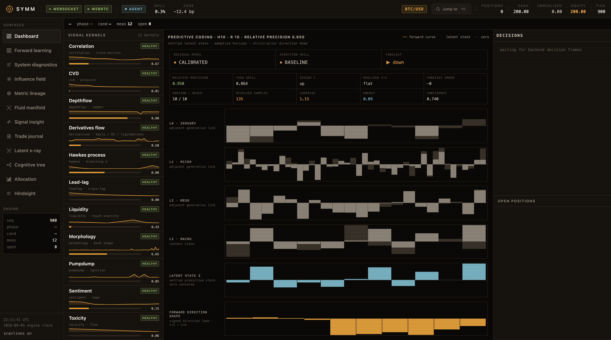

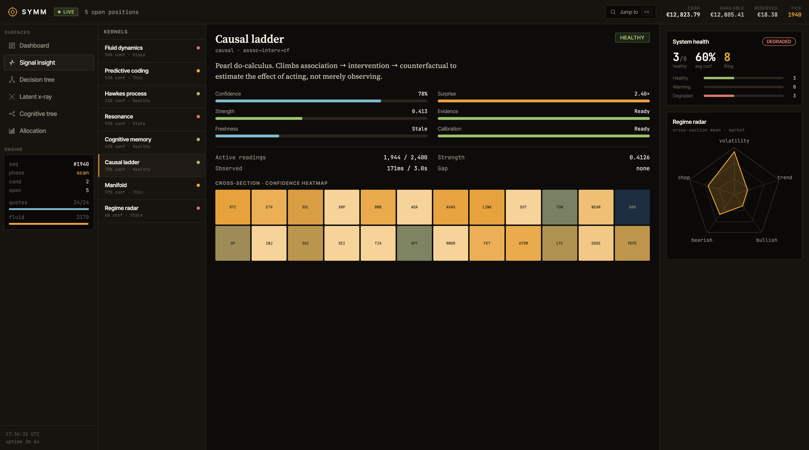

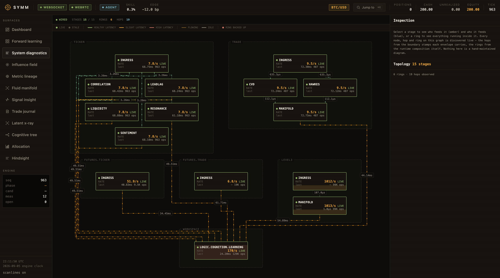

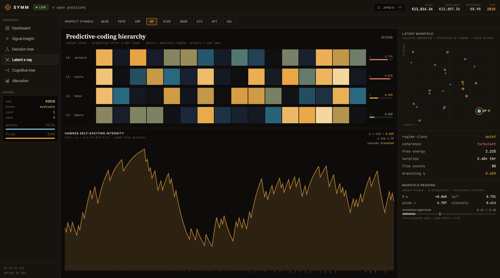

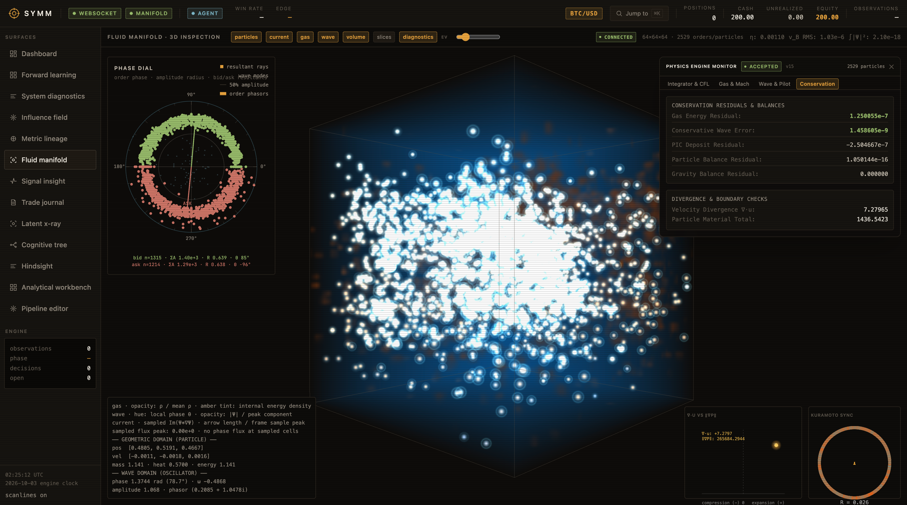

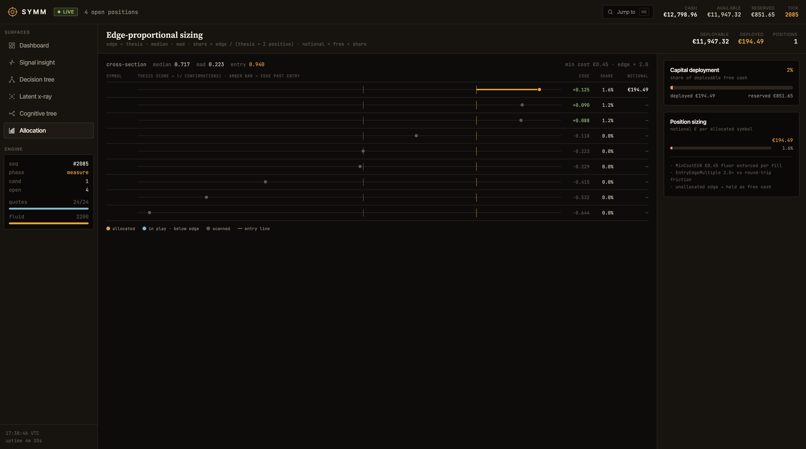

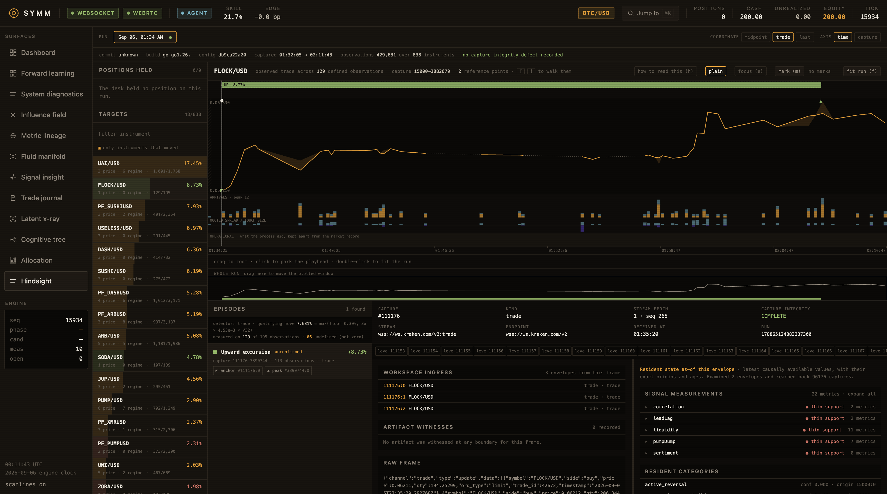

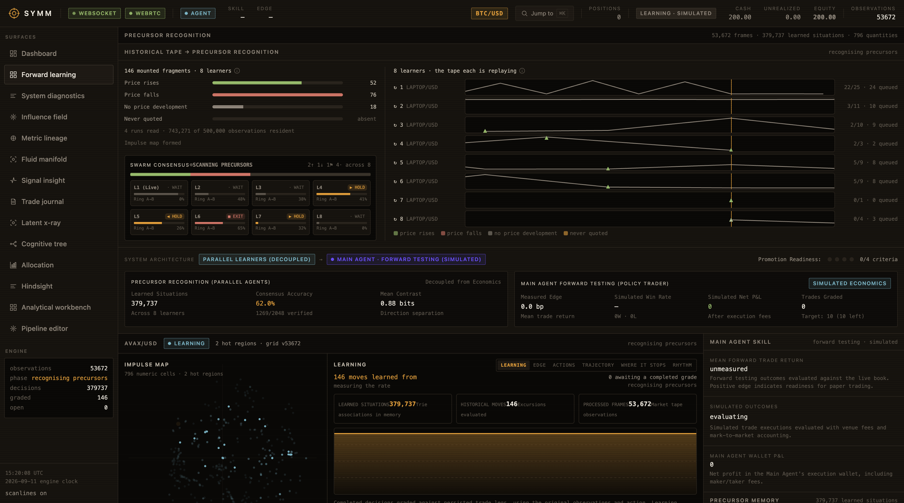

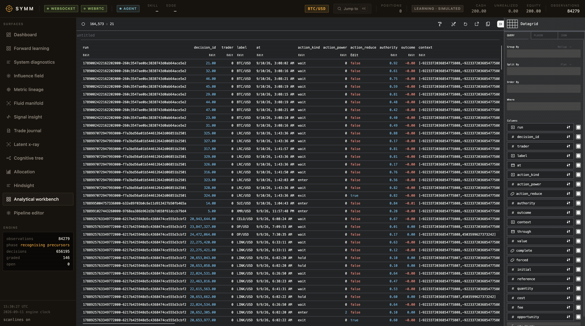

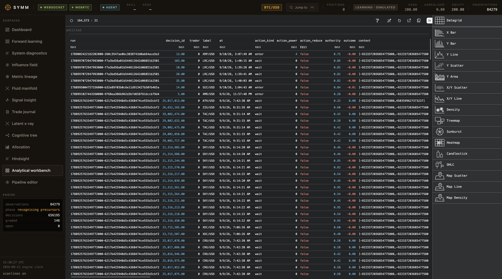

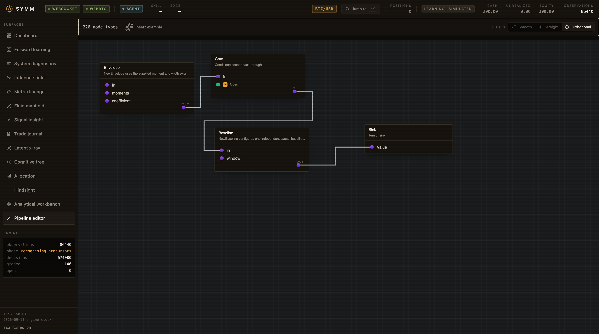

---

<sub>Personal research project · no warranty · not financial advice · may change or disappear at any time.</sub>
