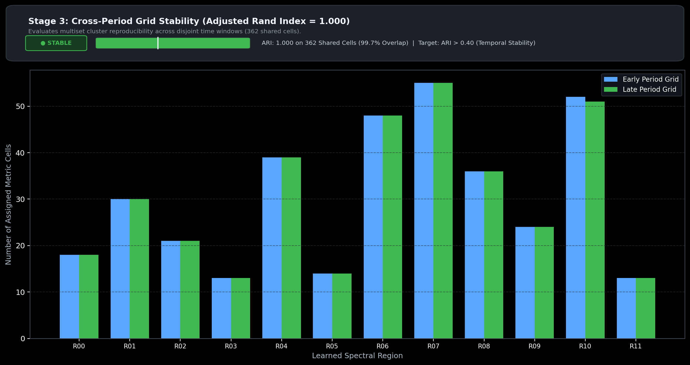

# SYMM Pipeline Empirical Audit

**State:** CONTRACT BREACHES PRESENT | **Epoch:** `1791761857882169000` | **Symbol:** `ALL` | **Ticks:** `292` | **Generated:** `2026-10-11T23:40:13Z`

Only VALID and SUPPORTED are passes. MEASURED is descriptive, NOT_A_TEST cannot fail by construction, INSUFFICIENT_DATA means not evaluated.

Thresholds: significance `0.05`, latency spike `200ms` on at most `5%`, dominance `0.40` bits, duplication `0.45` bits.

| Stage | Verdict | Criterion | Evidence |
| :--- | :---: | :--- | :--- |
| **0. Contracts** | **CONTRACT_BREACH** | declared hard domains on every observation; |z| <= sqrt(n/0.05) per stream | 0/352 series breach a domain (0 observations); 302 z beyond bound |
| **0.5 Timing** | **VALID** | no At regression per (source, symbol); spikes > 200ms on at most 5% | 0 inversions, 10 spikes of 4344 |
| **1. Vitality** | **MEASURED** | descriptive | 4685 raw series, 4685 canonical cells, 213 constant |
| **2. Sympathy** | **SUPPORTED** | within-symbol |r| exceedance vs block-shuffled null, p <= 0.05 | 274116 pairs, 16.7% above null p95, p=0.020 |
| **3. Grid stationarity** | **MEASURED** | JSD between halves vs tick-shuffled null; stationary when p > 0.05 (ARI is NOT_A_TEST) | JSD 1.000 bits, p=0.059 |
| **4. Token dynamics** | **INSUFFICIENT_DATA** | transition entropy below block null, p <= 0.05 | 0 emissions, H=0.000, p=0.000 |
| **5a. Ignition precursors** | **INSUFFICIENT_DATA** | event vs control excursions, excursion-label null, p <= 0.05 | JSD 0.000 bits, p=0.000 |
| **5b. Exhaustion precursors** | **INSUFFICIENT_DATA** | late vs early half within excursions, paired swap null, p <= 0.05 | JSD 0.000 bits, p=0.000 |
| **5c. Held-out precursor skill** | **INSUFFICIENT_DATA** | chronological 60/40 split, held-out MCC vs label null, p <= 0.05 | 0 held-out, MCC 0.000, p=0.000 |
| **5d. Friction clearance** | **INSUFFICIENT_DATA** | detections are defined as moves that clear friction | restates the detector's own criterion |
| **6. Simulated trie** | **INSUFFICIENT_DATA** | in-memory trie (not S3) balanced accuracy vs label-shuffled null, p <= 0.05 | balanced accuracy 0.0% |
| **V1. Equivalence** | **NOT_A_TEST** | one code path compared with itself | deterministic=true |
| **V2. Truthfulness** | **CONTRACT_BREACH** | cvd frames recomputed from the stored trade tape; every check exercised | 526 violations; unexercised [] |
| **V3. Causality** | **VALID** | replayed z-scores/tokens unchanged by perturbed future, other symbols, prior epochs | 38833 compared; changed: future 0, cross-symbol 0, epoch 0 |
| **V4. Sensitivity** | **SUPPORTED** | no family moves regions > 0.40 bits on removal or > 0.45 on duplication (named limits) | 0 dominant; max duplication 0.000 bits |

---

### Stage 0: Declared mathematical contracts

- Series checked: `352`
- Hard-domain breaches: `0` series (`0` observations)
- Standardized z-score bound breaches: `302` observations beyond Chebyshev bound |z| <= sqrt(N/0.05) (max |z|=`51496598.33`, saturated=`3.4%`)
- Normalization breaches: `0`, Standardization breaches: `0`

> The audit reports the disagreement only. It does not infer a root cause or clamp the observation to fit the contract.

### Stage 0.5: Ingestion clock timing & synchronization

- Observations checked: `4344`
- Ingestion latency (Timestamp - At): mean `-27.9ms`, p95 `82.7ms`, max `305.8ms`
- Latency spikes: `10`
- Sequence inversions (timestamp regressions): `0`
- Feed status: `VALID`

> Drift measures local ingest latency relative to venue event time. Sequence inversions indicate out-of-order ingress.

### Stage 1: Observed metric population

- Raw named series: `4685` (varying `4145`, constant `138`)
- Canonical grid cells: `4685` (varying `3017`, constant `213`)
- High-correlation canonical pairs shown by the current reference filter: `6557`

#### Constant / Dead Canonical Grid Cells

| Canonical Cell | Coverage | Zero Fraction | Range | Status |
| :--- | :---: | :---: | :---: | :---: |
| `correlation|AVAX/USD|covariance_score_velocity` | `90.0%` | `100.0%` | `[0.000, 0.000]` | `DEAD` |
| `correlation|AVAX/USD|relative_return_energy_velocity` | `90.0%` | `100.0%` | `[0.000, 0.000]` | `DEAD` |
| `correlation|B3/USD|relative_return_energy` | `78.9%` | `100.0%` | `[0.000, 0.000]` | `DEAD` |
| `correlation|B3/USD|return_energy_rate:measured` | `78.9%` | `100.0%` | `[0.000, 0.000]` | `DEAD` |
| `correlation|VIRTUAL/USD|covariance_score_velocity` | `69.2%` | `100.0%` | `[0.000, 0.000]` | `DEAD` |
| `correlation|VIRTUAL/USD|relative_return_energy_velocity` | `69.2%` | `100.0%` | `[0.000, 0.000]` | `DEAD` |
| `cvd|AVAX/USD|buy_notional_rate` | `90.0%` | `100.0%` | `[0.000, 0.000]` | `DEAD` |
| `cvd|AVAX/USD|gross_notional_rate` | `90.0%` | `100.0%` | `[0.000, 0.000]` | `DEAD` |
| `cvd|AVAX/USD|midpoint_return_rate` | `90.0%` | `100.0%` | `[0.000, 0.000]` | `DEAD` |
| `cvd|AVAX/USD|net_notional_rate` | `90.0%` | `100.0%` | `[0.000, 0.000]` | `DEAD` |
| `cvd|AVAX/USD|sell_notional_rate` | `90.0%` | `100.0%` | `[0.000, 0.000]` | `DEAD` |
| `cvd|AVAX/USD|trade_rate` | `90.0%` | `100.0%` | `[0.000, 0.000]` | `DEAD` |
| `cvd|B3/USD|aggressive_notional:buy` | `68.4%` | `100.0%` | `[0.000, 0.000]` | `DEAD` |
| `cvd|B3/USD|buy_notional_rate` | `94.7%` | `100.0%` | `[0.000, 0.000]` | `DEAD` |
| `cvd|B3/USD|executed_quantity:buy` | `68.4%` | `100.0%` | `[0.000, 0.000]` | `DEAD` |
| `cvd|B3/USD|gross_notional_rate_zscore` | `47.4%` | `100.0%` | `[0.000, 0.000]` | `DEAD` |
| `cvd|B3/USD|signed_count_fraction` | `68.4%` | `100.0%` | `[0.000, 0.000]` | `DEAD` |
| `cvd|B3/USD|signed_net_fraction` | `68.4%` | `100.0%` | `[0.000, 0.000]` | `DEAD` |
| `cvd|B3/USD|signed_net_fraction_baseline` | `63.2%` | `100.0%` | `[0.000, 0.000]` | `DEAD` |
| `cvd|B3/USD|signed_net_fraction_divergence` | `63.2%` | `100.0%` | `[0.000, 0.000]` | `DEAD` |
| `cvd|B3/USD|trade_count:buy` | `68.4%` | `100.0%` | `[0.000, 0.000]` | `DEAD` |
| `cvd|QNT/USD|buy_notional_rate` | `90.0%` | `100.0%` | `[0.000, 0.000]` | `DEAD` |
| `cvd|QNT/USD|gross_notional_rate` | `90.0%` | `100.0%` | `[0.000, 0.000]` | `DEAD` |
| `cvd|QNT/USD|net_notional_rate` | `90.0%` | `100.0%` | `[0.000, 0.000]` | `DEAD` |
| `cvd|QNT/USD|sell_notional_rate` | `90.0%` | `100.0%` | `[0.000, 0.000]` | `DEAD` |
| `cvd|QNT/USD|trade_rate` | `90.0%` | `100.0%` | `[0.000, 0.000]` | `DEAD` |
| `cvd|VIRTUAL/USD|gross_notional_rate_baseline` | `69.2%` | `100.0%` | `[0.000, 0.000]` | `DEAD` |
| `cvd|VIRTUAL/USD|gross_notional_rate_divergence` | `69.2%` | `100.0%` | `[0.000, 0.000]` | `DEAD` |
| `cvd|VIRTUAL/USD|gross_notional_rate_ratio` | `69.2%` | `100.0%` | `[0.000, 0.000]` | `DEAD` |
| `cvd|VIRTUAL/USD|gross_notional_rate_velocity` | `69.2%` | `100.0%` | `[0.000, 0.000]` | `DEAD` |
| `cvd|VIRTUAL/USD|midpoint_return_rate_baseline` | `69.2%` | `100.0%` | `[0.000, 0.000]` | `DEAD` |
| `cvd|VIRTUAL/USD|midpoint_return_rate_divergence` | `69.2%` | `100.0%` | `[0.000, 0.000]` | `DEAD` |
| `cvd|VIRTUAL/USD|net_notional_rate_velocity` | `69.2%` | `100.0%` | `[0.000, 0.000]` | `DEAD` |
| `depthflow|AVAX/USD|added_notional_rate:ask` | `90.0%` | `100.0%` | `[0.000, 0.000]` | `DEAD` |
| `depthflow|AVAX/USD|added_notional_rate:bid` | `90.0%` | `100.0%` | `[0.000, 0.000]` | `DEAD` |
| `depthflow|AVAX/USD|book_turnover_rate` | `90.0%` | `100.0%` | `[0.000, 0.000]` | `DEAD` |
| `depthflow|AVAX/USD|net_book_change_rate` | `90.0%` | `100.0%` | `[0.000, 0.000]` | `DEAD` |
| `depthflow|AVAX/USD|net_displayed_flow_rate:ask` | `90.0%` | `100.0%` | `[0.000, 0.000]` | `DEAD` |
| `depthflow|AVAX/USD|net_displayed_flow_rate:bid` | `90.0%` | `100.0%` | `[0.000, 0.000]` | `DEAD` |
| `depthflow|AVAX/USD|removed_notional_rate:ask` | `90.0%` | `100.0%` | `[0.000, 0.000]` | `DEAD` |
| `depthflow|AVAX/USD|removed_notional_rate:bid` | `90.0%` | `100.0%` | `[0.000, 0.000]` | `DEAD` |
| `depthflow|AVAX/USD|signed_net_displayed_flow_rate` | `90.0%` | `100.0%` | `[0.000, 0.000]` | `DEAD` |
| `depthflow|VIRTUAL/USD|net_book_change_rate_baseline` | `69.2%` | `100.0%` | `[0.000, 0.000]` | `DEAD` |
| `depthflow|VIRTUAL/USD|net_book_change_rate_divergence` | `69.2%` | `100.0%` | `[0.000, 0.000]` | `DEAD` |
| `depthflow|VIRTUAL/USD|signed_net_displayed_flow_rate_baseline` | `69.2%` | `100.0%` | `[0.000, 0.000]` | `DEAD` |
| `depthflow|VIRTUAL/USD|signed_net_displayed_flow_rate_divergence` | `69.2%` | `100.0%` | `[0.000, 0.000]` | `DEAD` |
| `depthflow|VIRTUAL/USD|turnover_baseline` | `69.2%` | `100.0%` | `[0.000, 0.000]` | `DEAD` |
| `depthflow|VIRTUAL/USD|turnover_divergence` | `69.2%` | `100.0%` | `[0.000, 0.000]` | `DEAD` |
| `depthflow|VIRTUAL/USD|turnover_ratio` | `69.2%` | `100.0%` | `[0.000, 0.000]` | `DEAD` |
| `hawkes|B3/USD|arrival_rate:buy` | `94.7%` | `100.0%` | `[0.000, 0.000]` | `DEAD` |
| ... and 163 more dead cells | | | | |

#### Stagnant / Cold-Start Canonical Cells (>=80% Zero)

| Canonical Cell | Coverage | Zero Fraction | Mean | Status |
| :--- | :---: | :---: | :---: | :---: |
| `correlation|GRASS/USD|absolute_covariance_score` | `88.9%` | `87.5%` | `-1.1737` | `COLD_START` |
| `correlation|GRASS/USD|cohort_absolute_covariance_score` | `88.9%` | `87.5%` | `-0.1525` | `COLD_START` |
| `correlation|GRASS/USD|cohort_covariance_score` | `88.9%` | `87.5%` | `0.5318` | `COLD_START` |
| `correlation|GRASS/USD|cohort_covariance_score_dispersion` | `88.9%` | `87.5%` | `0.0292` | `COLD_START` |
| `correlation|GRASS/USD|cohort_effective_peer_count` | `88.9%` | `87.5%` | `0.6519` | `COLD_START` |
| `correlation|GRASS/USD|cohort_peer_count` | `88.9%` | `87.5%` | `0.5610` | `COLD_START` |
| `correlation|GRASS/USD|covariance` | `88.9%` | `87.5%` | `1.9977` | `COLD_START` |
| `correlation|GRASS/USD|covariance_p_value` | `88.9%` | `87.5%` | `1.3184` | `COLD_START` |
| `correlation|GRASS/USD|covariance_score` | `88.9%` | `87.5%` | `2.1450` | `COLD_START` |
| `correlation|GRASS/USD|covariance_score_baseline` | `88.9%` | `87.5%` | `0.7945` | `COLD_START` |
| `correlation|GRASS/USD|covariance_score_divergence` | `88.9%` | `87.5%` | `0.4286` | `COLD_START` |
| `correlation|GRASS/USD|covariance_score_zscore` | `88.9%` | `87.5%` | `0.4276` | `COLD_START` |
| `correlation|GRASS/USD|covariance_standard_error` | `88.9%` | `87.5%` | `1.0425` | `COLD_START` |
| `correlation|GRASS/USD|overlap_density` | `88.9%` | `87.5%` | `-0.1771` | `COLD_START` |
| `correlation|GRASS/USD|overlap_pair_count` | `88.9%` | `87.5%` | `-0.0072` | `COLD_START` |
| ... and 481 more stagnant cells | | | | |

> Coverage is reported per metric but is not itself a health threshold. High pairwise correlation is not treated as proof that a metric can be removed.

### Stage 2: Sympathy against an empirical null

- Simultaneously observed pairs: `274116`
- Direct relationships: `137338`; inverse relationships: `136778`
- Signed real mean: `0.017`; signed shuffled mean: `-0.000`
- 95th percentile of `|null r|`: `0.547`
- Real `|r|` above that empirical bound: `16.7%`
- KS distance in `|r|` space: `0.158`

> Missing deformations remain missing in both real and shuffled populations; the null preserves each channel's observation mask.

### Stage 3: Grid reproducibility

- Early grid: `352` cells / `12` regions
- Late grid: `352` cells / `12` regions
- Shared universe: `352` cells (`100.0%`)
- Adjusted Rand Index: `1.000`

> Balanced region sizes are enforced by the partitioner and are not presented as empirical evidence. No ARI health cutoff is applied.

### Stage 4: Held-out token dynamics & excitation strength

- Held-out emissions: `0` across `0` regions
- Excitation strength: mean `0.000`, peak `0.000`, runner-up margin `0.000`
- Active cell coverage: `0.0%` mean
- Maximum observed token share: `0.0%`
- Real transition entropy: `0.000` bits
- Empirical dwell-block null mean: `0.000` bits
- Difference (null - real): `0.000` bits

> The same causal Stream continues across the train/holdout boundary. The report does not turn an entropy difference into a PASS/FAIL cutoff.

### Stage 5: Event-centred precursor populations

#### 1. Statistical Separation
- Detections: `0` ()
- A->B Ignition: `INSUFFICIENT_DATA`, event/control `0/0`, JSD `0.000` vs null95 `0.000`
- B->C Exhaustion: `INSUFFICIENT_DATA`, event/control `0/0`, JSD `0.000` vs null95 `0.000`
- Supplemental non-excursion background observations: `0`

#### 2. Predictive Skill (Anticipation)
- Balanced Accuracy: `0.0%` | MCC: `0.000`
- Precision / Recall: `0.0%` / `0.0%`
- Mutual Information (Predictive Gain): `0.000` bits
- Prior Base Rate: `0.0%` | Top Precursor Tokens: ``

#### 3. Economic Relevance (Friction Clearance)
- Evaluated Excursions: `0` | Round-Trip Taker Fee: `0.00` bps
- Friction Clearance Rate: `0.0%` (`0` profitable / `0` unprofitable)
- Gross Mean Return: `0.00%` | Net Mean Return after Fees: `0.00%`

> Current trading semantics are long-only: only profitable `up` excursions populate the positive A->B set. Event windows are loaded directly from the archive rather than requiring them to occur inside the first-N audit sample.

### Stage 6: Cognitive Engine & Radix Trie Learning Dynamics

- Evaluated excursions: `0` forming `0` sequential phases (enter: `0`, exit: `0`, wait: `0`)
- Balanced accuracy: `0.0%` vs best baseline (``): `0.0%` (Raw hit rate: `0/0` `0.0%`)
- Matthews Correlation Coefficient (MCC): `0.000`
- Enter action precision / recall: `0.0%` / `0.0%`
- Label-shuffled empirical null balanced accuracy: mean `0.0%`, 95th percentile `0.0%` (empirical p-value: `0.000`)
- Separates from null: `false`
- Post-teach memory retention: `0/0` (`0.0%`)
- Trie topology: `0` nodes, max depth `0`, mean depth `0.0`, branching factor `0.00`
- Basin geometry: records `0`, span `0`, active enter basins `0`, active exit basins `0` (total: `0`)
- Decisiveness: abstention rate `0.0%`, mean confidence `0.000`, mean contrast `0.000`
- Unseen background false-alarm rate: `0.00%` spurious triggers on continuous tape

> Prequential recall evaluates the trie strictly before learning each phase. Abstention is the appropriate stance on controls, not a terminal action. Shuffled null tests whether sequential prefix structure holds predictive edge over class priors.

### Validation 1: Production-vs-Audit Equivalence

- Replayed ticks: `292`
- Tokens verified: `301`
- Token mismatches: `0`
- Metric/brightness mismatches: `0`
- Executable path: `/var/folders/30/bdbpd0hj5wddgkxyx8pbc0mc0000gn/T/go-build3143836166/b001/exe/main`
- Verdict: `NOT_A_TEST` (one code path compared with itself)

### Validation 2: Metric Truthfulness

- Measurements audited: `438`
- Physical invariant violations: `526`
- Same-time ambiguous trades skipped: `213`
- Comparisons per check: `map[buy_notional_rate:213 cvd_coverage:225 midpoint_log_return:207 rate_without_elapsed_time:65 response_midpoint:at:207 response_midpoint:from:207 sell_notional_rate:213 signed_net_fraction_bounded:193 trade_fields:438 trade_rate:213]`
- Violations per check: `map[midpoint_log_return:143 response_midpoint:at:190 response_midpoint:from:193]`
- Unexercised checks: `[]`
- Verdict: `CONTRACT_BREACH`

### Validation 3: Causality & State Isolation

- Future perturbation ticks: `2070`
- Lookahead leakage detected: `false` (compared: `38833`, contaminated: `0`)
- Cross-symbol contamination: `false`
- Epoch isolation passed: `true`
- Verdict: `VALID`

### Validation 4: Grid Dependence & Sensitivity

- Families evaluated (LOFO): `10`
- Duplication resistant: `true`
- Verdict: `SUPPORTED`

  - Family `correlation`: Removed JSD = `0.000` bits (dominant: `false`)
  - Family `cvd`: Removed JSD = `0.169` bits (dominant: `false`)
  - Family `depthflow`: Removed JSD = `0.000` bits (dominant: `false`)
  - Family `hawkes`: Removed JSD = `0.117` bits (dominant: `false`)
  - Family `leadlag`: Removed JSD = `0.029` bits (dominant: `false`)
  - Family `liquidity`: Removed JSD = `0.111` bits (dominant: `false`)
  - Family `morphology`: Removed JSD = `0.052` bits (dominant: `false`)
  - Family `pumpdump`: Removed JSD = `0.111` bits (dominant: `false`)
  - Family `sentiment`: Removed JSD = `0.000` bits (dominant: `false`)
  - Family `toxicity`: Removed JSD = `0.163` bits (dominant: `false`)

