# SYMM Pipeline Empirical Audit

**State:** INCOMPLETE EVIDENCE | **Epoch:** `1791940457228078000` | **Symbol:** `ALL` | **Ticks:** `10886` | **Generated:** `2026-10-14T01:35:24Z`

Only VALID and SUPPORTED are passes. MEASURED is descriptive, NOT_A_TEST cannot fail by construction, INSUFFICIENT_DATA means not evaluated.

Thresholds: significance `0.05`, latency spike `200ms` on at most `5%`, dominance `0.40` bits, duplication `0.45` bits.

| Stage | Verdict | Criterion | Evidence |
| :--- | :---: | :--- | :--- |
| **0. Contracts** | **VALID** | declared hard domains on every observation; bounded SNM in [-1, 1]; valid state | 0/43 domain breaches; 0 norm breaches; state pass=true |
| **0.5 Timing** | **VALID** | no At regression per (source, symbol); spikes > 200ms on at most 5% | 0 inversions, 0 spikes of 108424 |
| **1. Vitality** | **MEASURED** | descriptive | 8830 raw series, 8830 canonical cells, 836 constant |
| **2. Sympathy** | **SUPPORTED** | within-symbol |r| exceedance vs block-shuffled null, p <= 0.05 | 72432 pairs, 11.7% above null p95, p=0.020 |
| **3. Grid stationarity** | **MEASURED** | JSD between halves vs tick-shuffled null; stationary when p > 0.05 (ARI is NOT_A_TEST) | JSD 0.020 bits, p=0.020 |
| **4. Token dynamics** | **SUPPORTED** | transition entropy below block null, p <= 0.05 | 4355 emissions, H=2.995, p=0.020 |
| **5a. Ignition precursors** | **INSUFFICIENT_DATA** | event vs control excursions, excursion-label null, p <= 0.05 | JSD 0.000 bits, p=0.000 |
| **5b. Exhaustion precursors** | **INSUFFICIENT_DATA** | late vs early half within excursions, paired swap null, p <= 0.05 | JSD 0.000 bits, p=0.000 |
| **5c. Held-out precursor skill** | **INSUFFICIENT_DATA** | chronological 60/40 split, held-out MCC vs label null, p <= 0.05 | 0 held-out, MCC 0.000, p=0.000 |
| **5d. Friction clearance** | **INSUFFICIENT_DATA** | detections are defined as moves that clear friction | restates the detector's own criterion |
| **6. Simulated trie** | **INSUFFICIENT_DATA** | in-memory trie (not S3) balanced accuracy vs label-shuffled null, p <= 0.05 | balanced accuracy 0.0% |
| **V1. Equivalence** | **NOT_A_TEST** | one code path compared with itself | deterministic=true |
| **V2. Truthfulness** | **VALID** | cvd frames recomputed from the stored trade tape; every check exercised | 0 violations; unexercised [] |
| **V3. Causality** | **VALID** | replayed z-scores/tokens unchanged by perturbed future, other symbols, prior epochs | 182562 compared; changed: future 0, cross-symbol 0, epoch 0 |
| **V4. Sensitivity** | **SUPPORTED** | no family moves regions > 0.40 bits on removal or > 0.45 on duplication (named limits) | 0 dominant; max duplication 0.010 bits |

---

### Stage 0: Declared mathematical contracts

- Series checked: `43`
- Hard-domain breaches: `0` series (`0` observations)
- Standardized z-score bound breaches: `0` observations beyond rank bound |z| <= rankBound(support) (max |z|=`1.00`, saturated=`4.1%`)
- Normalization breaches: `0`, Standardization breaches: `0`

> The audit reports the disagreement only. It does not infer a root cause or clamp the observation to fit the contract.

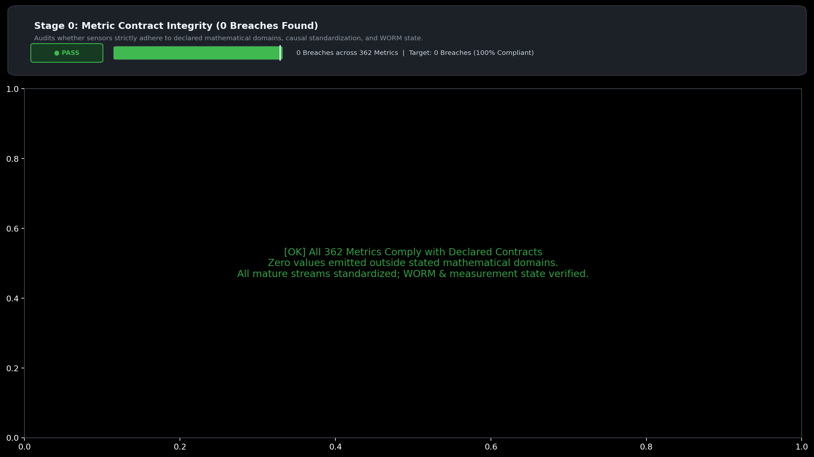

### Stage 0.5: Ingestion clock timing & synchronization

- Observations checked: `108424`
- Ingestion latency (Timestamp - At): mean `-50.4ms`, p95 `-25.3ms`, max `78.9ms`
- Latency spikes: `0`
- Sequence inversions (timestamp regressions): `0`
- Feed status: `VALID`

> Drift measures local ingest latency relative to venue event time. Sequence inversions indicate out-of-order ingress.

### Stage 1: Observed metric population

- Raw named series: `8830` (varying `7010`, constant `788`, warming `780`)
- Canonical grid cells: `8830` (varying `6962`, constant `836`, warming `780`)
- High-correlation canonical pairs shown by the current reference filter: `382`

#### Constant / Dead Canonical Grid Cells

| Canonical Cell | Coverage | Zero Fraction | Range | Status |
| :--- | :---: | :---: | :---: | :---: |
| `correlation|CSPR/USD|cohort_covariance_score` | `75.0%` | `100.0%` | `[0.000, 0.000]` | `DEAD` |
| `correlation|EGLD/USD|historical_path_percentile` | `66.7%` | `100.0%` | `[0.000, 0.000]` | `DEAD` |
| `correlation|FLR/USD|cohort_covariance_score` | `27.3%` | `100.0%` | `[0.000, 0.000]` | `DEAD` |
| `correlation|HFT/USD|cohort_covariance_score` | `66.7%` | `100.0%` | `[0.000, 0.000]` | `DEAD` |
| `correlation|QUID/USD|cohort_covariance_score` | `20.0%` | `100.0%` | `[0.000, 0.000]` | `DEAD` |
| `cvd|ADI/USD|gross_notional` | `50.0%` | `100.0%` | `[0.000, 0.000]` | `DEAD` |
| `cvd|ADI/USD|signed_net_fraction` | `50.0%` | `100.0%` | `[0.000, 0.000]` | `DEAD` |
| `cvd|AMI/USD|gross_notional` | `60.0%` | `100.0%` | `[0.000, 0.000]` | `DEAD` |
| `cvd|AMI/USD|signed_net_fraction` | `60.0%` | `100.0%` | `[0.000, 0.000]` | `DEAD` |
| `cvd|AVA/USD|gross_notional` | `40.0%` | `100.0%` | `[0.000, 0.000]` | `DEAD` |
| `cvd|AVA/USD|signed_net_fraction` | `40.0%` | `100.0%` | `[0.000, 0.000]` | `DEAD` |
| `cvd|BLUAI/USD|gross_notional` | `40.0%` | `100.0%` | `[0.000, 0.000]` | `DEAD` |
| `cvd|BLUAI/USD|signed_net_fraction` | `40.0%` | `100.0%` | `[0.000, 0.000]` | `DEAD` |
| `cvd|BONK/USD|signed_net_fraction` | `50.0%` | `100.0%` | `[0.000, 0.000]` | `DEAD` |
| `cvd|CPOOL/USD|signed_net_fraction` | `77.8%` | `100.0%` | `[0.000, 0.000]` | `DEAD` |
| `cvd|CSPR/USD|signed_net_fraction` | `50.0%` | `100.0%` | `[0.000, 0.000]` | `DEAD` |
| `cvd|DAG/USD|flow_aligned_midpoint_return` | `80.0%` | `100.0%` | `[0.000, 0.000]` | `DEAD` |
| `cvd|DAG/USD|gross_notional` | `60.0%` | `100.0%` | `[0.000, 0.000]` | `DEAD` |
| `cvd|DAG/USD|midpoint_log_return` | `80.0%` | `100.0%` | `[0.000, 0.000]` | `DEAD` |
| `cvd|DAG/USD|signed_net_fraction` | `60.0%` | `100.0%` | `[0.000, 0.000]` | `DEAD` |
| `cvd|DOS/USD|signed_net_fraction` | `71.4%` | `100.0%` | `[0.000, 0.000]` | `DEAD` |
| `cvd|ELX/USD|signed_net_fraction` | `83.3%` | `100.0%` | `[0.000, 0.000]` | `DEAD` |
| `cvd|FLOW/USD|flow_aligned_midpoint_return` | `75.0%` | `100.0%` | `[0.000, 0.000]` | `DEAD` |
| `cvd|FLOW/USD|midpoint_log_return` | `75.0%` | `100.0%` | `[0.000, 0.000]` | `DEAD` |
| `cvd|FLR/USD|flow_aligned_midpoint_return` | `90.9%` | `100.0%` | `[0.000, 0.000]` | `DEAD` |
| `cvd|FLR/USD|midpoint_log_return` | `90.9%` | `100.0%` | `[0.000, 0.000]` | `DEAD` |
| `cvd|FOLKS/USD|gross_notional` | `50.0%` | `100.0%` | `[0.000, 0.000]` | `DEAD` |
| `cvd|FOLKS/USD|signed_net_fraction` | `50.0%` | `100.0%` | `[0.000, 0.000]` | `DEAD` |
| `cvd|GALA/USD|flow_aligned_midpoint_return` | `75.0%` | `100.0%` | `[0.000, 0.000]` | `DEAD` |
| `cvd|GALA/USD|midpoint_log_return` | `75.0%` | `100.0%` | `[0.000, 0.000]` | `DEAD` |
| `cvd|GALA/USD|signed_net_fraction` | `50.0%` | `100.0%` | `[0.000, 0.000]` | `DEAD` |
| `cvd|GNOT/USD|flow_aligned_midpoint_return` | `85.7%` | `100.0%` | `[0.000, 0.000]` | `DEAD` |
| `cvd|GNOT/USD|midpoint_log_return` | `85.7%` | `100.0%` | `[0.000, 0.000]` | `DEAD` |
| `cvd|GRT/USD|gross_notional` | `50.0%` | `100.0%` | `[0.000, 0.000]` | `DEAD` |
| `cvd|GRT/USD|signed_net_fraction` | `50.0%` | `100.0%` | `[0.000, 0.000]` | `DEAD` |
| `cvd|JTO/USD|signed_net_fraction` | `95.5%` | `100.0%` | `[0.000, 0.000]` | `DEAD` |
| `cvd|LCX/USD|signed_net_fraction` | `60.0%` | `100.0%` | `[0.000, 0.000]` | `DEAD` |
| `cvd|LSK/USD|signed_net_fraction` | `75.0%` | `100.0%` | `[0.000, 0.000]` | `DEAD` |
| `cvd|MLN/USD|signed_net_fraction` | `40.0%` | `100.0%` | `[0.000, 0.000]` | `DEAD` |
| `cvd|OMI/USD|signed_net_fraction` | `75.0%` | `100.0%` | `[0.000, 0.000]` | `DEAD` |
| `cvd|PLUME/USD|signed_net_fraction` | `25.0%` | `100.0%` | `[0.000, 0.000]` | `DEAD` |
| `cvd|PNUT/USD|signed_net_fraction` | `88.9%` | `100.0%` | `[0.000, 0.000]` | `DEAD` |
| `cvd|QUID/USD|flow_aligned_midpoint_return` | `90.0%` | `100.0%` | `[0.000, 0.000]` | `DEAD` |
| `cvd|QUID/USD|midpoint_log_return` | `90.0%` | `100.0%` | `[0.000, 0.000]` | `DEAD` |
| `cvd|QUID/USD|signed_net_fraction` | `80.0%` | `100.0%` | `[0.000, 0.000]` | `DEAD` |
| `cvd|RSC/USD|signed_net_fraction` | `66.7%` | `100.0%` | `[0.000, 0.000]` | `DEAD` |
| `cvd|RSR/USD|signed_net_fraction` | `92.3%` | `100.0%` | `[0.000, 0.000]` | `DEAD` |
| `cvd|RUNE/USD|signed_net_fraction` | `57.1%` | `100.0%` | `[0.000, 0.000]` | `DEAD` |
| `cvd|SKY/USD|gross_notional` | `50.0%` | `100.0%` | `[0.000, 0.000]` | `DEAD` |
| `cvd|SKY/USD|signed_net_fraction` | `50.0%` | `100.0%` | `[0.000, 0.000]` | `DEAD` |
| ... and 786 more dead cells | | | | |

#### Stagnant / Cold-Start Canonical Cells (>=80% Zero)

| Canonical Cell | Coverage | Zero Fraction | Mean | Status |
| :--- | :---: | :---: | :---: | :---: |
| `correlation|BICO/USD|historical_path_percentile` | `61.1%` | `90.9%` | `-0.0355` | `COLD_START` |
| `correlation|ELX/USD|cohort_covariance_score` | `50.0%` | `83.3%` | `-0.0010` | `COLD_START` |
| `correlation|SEI/USD|cohort_covariance_score` | `95.1%` | `84.6%` | `0.0235` | `COLD_START` |
| `cvd|AERO/USD|signed_net_fraction` | `90.5%` | `89.5%` | `0.0000` | `COLD_START` |
| `cvd|AKT/USD|signed_net_fraction` | `94.6%` | `91.4%` | `-0.0190` | `COLD_START` |
| `cvd|AVAX/USD|signed_net_fraction` | `93.5%` | `82.8%` | `-0.0251` | `COLD_START` |
| `cvd|AXS/USD|signed_net_fraction` | `88.9%` | `81.2%` | `0.0208` | `COLD_START` |
| `cvd|BCH/USD|signed_net_fraction` | `84.6%` | `90.9%` | `0.0613` | `COLD_START` |
| `cvd|BEAM/USD|gross_notional` | `71.4%` | `80.0%` | `-0.0553` | `COLD_START` |
| `cvd|BEAM/USD|signed_net_fraction` | `71.4%` | `80.0%` | `-0.0401` | `COLD_START` |
| `cvd|BICO/USD|flow_aligned_midpoint_return` | `94.4%` | `88.2%` | `-0.0294` | `COLD_START` |
| `cvd|BICO/USD|midpoint_log_return` | `94.4%` | `88.2%` | `-0.0294` | `COLD_START` |
| `cvd|BICO/USD|signed_net_fraction` | `77.8%` | `85.7%` | `0.0083` | `COLD_START` |
| `cvd|BNB/USD|signed_net_fraction` | `97.8%` | `88.6%` | `-0.0100` | `COLD_START` |
| `cvd|BRL1/USD|signed_net_fraction` | `62.5%` | `80.0%` | `-0.1537` | `COLD_START` |
| ... and 397 more stagnant cells | | | | |

> Coverage is reported per metric but is not itself a health threshold. High pairwise correlation is not treated as proof that a metric can be removed.

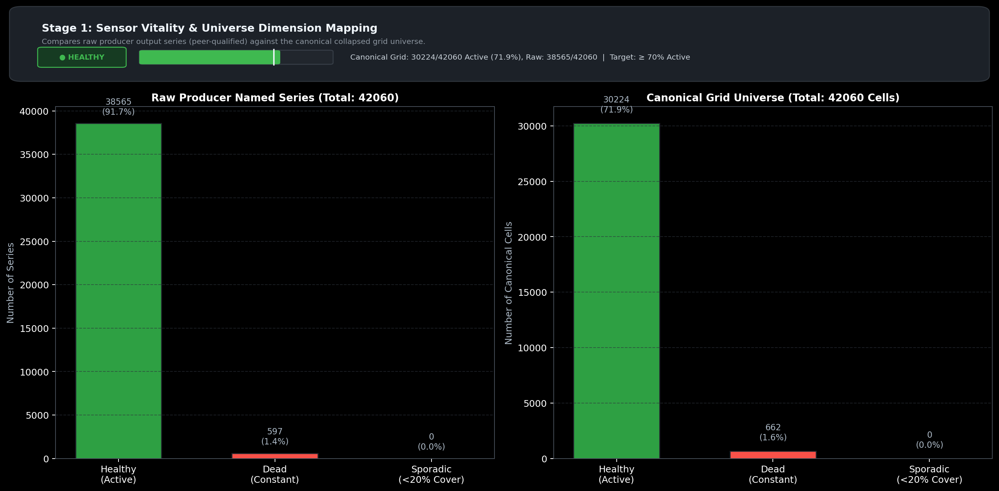

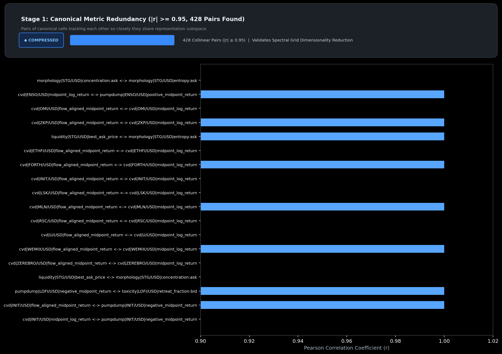

### Stage 2: Sympathy against an empirical null

- Simultaneously observed pairs: `72432`
- Direct relationships: `36546`; inverse relationships: `35839`
- Signed real mean: `0.008`; signed shuffled mean: `0.000`
- 95th percentile of `|null r|`: `0.429`
- Real `|r|` above that empirical bound: `11.7%`
- KS distance in `|r|` space: `0.119`

> Missing deformations remain missing in both real and shuffled populations; the null preserves each channel's observation mask.

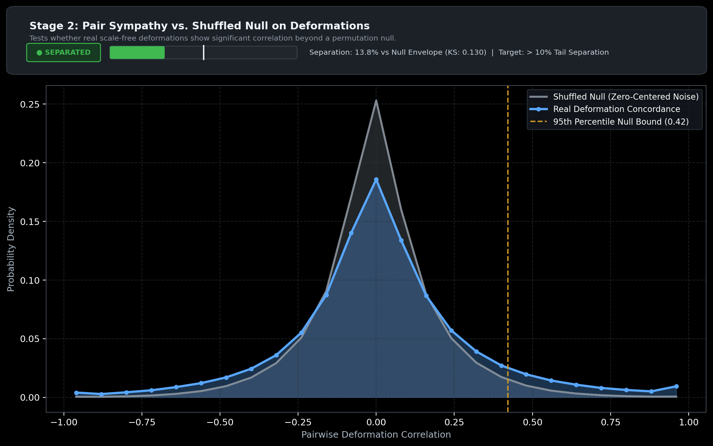

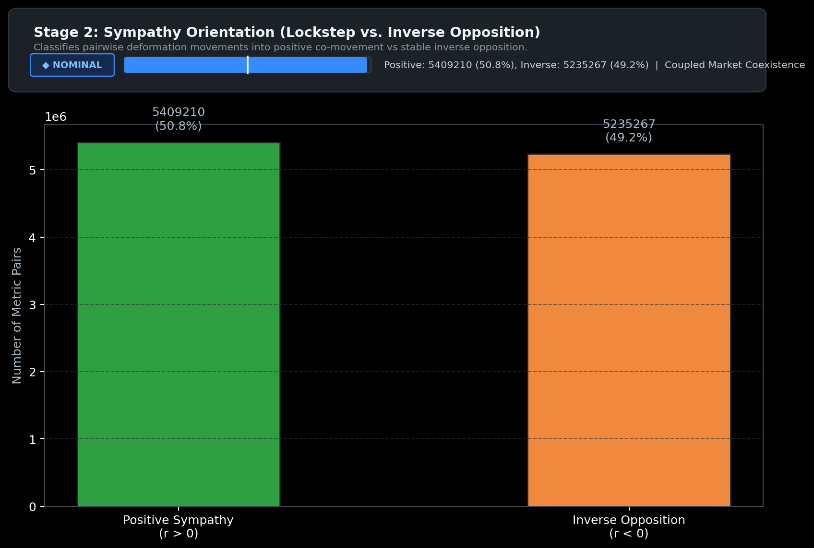

### Stage 3: Grid stationarity & completeness

- Cross-half excitation JSD: `0.020` bits (TVD `0.099`, p=`0.020`)
- Frames observed by the grid: `10843` of `10886` (`99.6%`)

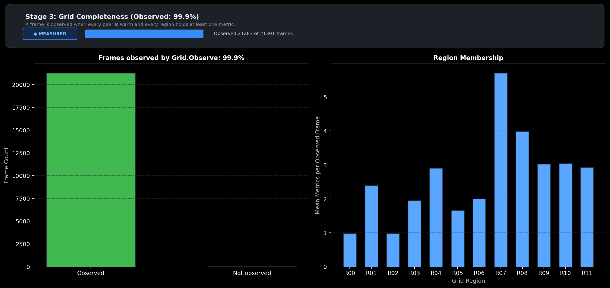

### Stage 4: Held-out token dynamics & excitation strength

- Held-out emissions: `4355` across `12` regions
- Excitation strength: mean `1.122`, peak `4.545`, runner-up margin `0.326`
- Active cell coverage: `100.0%` mean
- Maximum observed token share: `22.0%`
- Real transition entropy: `2.995` bits
- Empirical dwell-block null mean: `3.069` bits
- Difference (null - real): `0.075` bits

> The same causal Stream continues across the train/holdout boundary. The report does not turn an entropy difference into a PASS/FAIL cutoff.

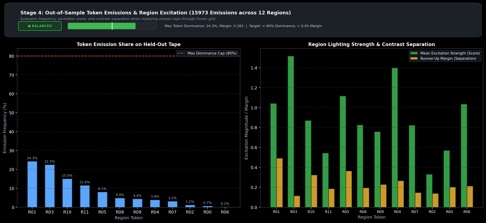

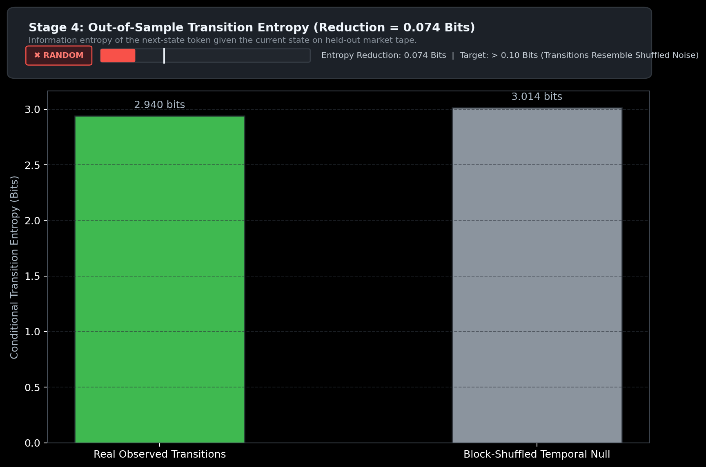

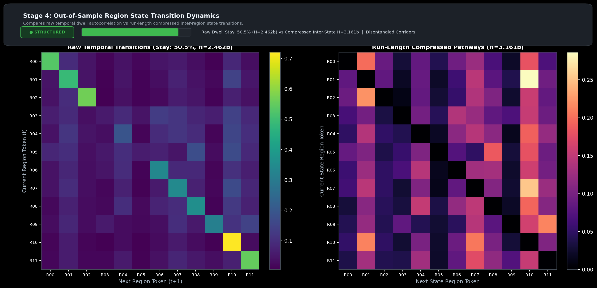

### Stage 5: Event-centred precursor populations

#### 1. Statistical Separation
- Detections: `0` ()
- A->B Ignition: `INSUFFICIENT_DATA`, event/control `0/0`, JSD `0.000` vs null95 `0.000`
- B->C Exhaustion: `INSUFFICIENT_DATA`, event/control `0/0`, JSD `0.000` vs null95 `0.000`
- Supplemental non-excursion background observations: `0`

#### 2. Predictive Skill (Anticipation)
- Balanced Accuracy: `0.0%` | MCC: `0.000`
- Precision / Recall: `0.0%` / `0.0%`
- Mutual Information (Predictive Gain): `0.000` bits
- Prior Base Rate: `0.0%` | Top Precursor Tokens: ``

#### 3. Economic Relevance (Friction Clearance)
- Evaluated Excursions: `0` | Round-Trip Taker Fee: `0.00` bps
- Friction Clearance Rate: `0.0%` (`0` profitable / `0` unprofitable)
- Gross Mean Return: `0.00%` | Net Mean Return after Fees: `0.00%`

> Current trading semantics are long-only: only profitable `up` excursions populate the positive A->B set. Event windows are loaded directly from the archive rather than requiring them to occur inside the first-N audit sample.

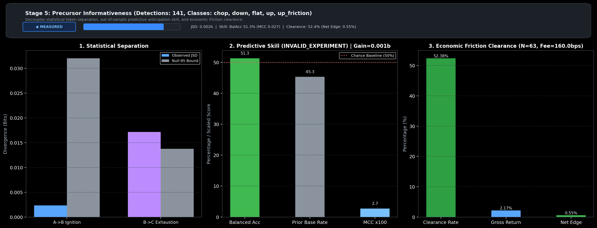

### Stage 6: Cognitive Engine & Radix Trie Learning Dynamics

- Evaluated excursions: `0` forming `0` sequential phases (enter: `0`, exit: `0`, wait: `0`)
- Balanced accuracy: `0.0%` vs best baseline (``): `0.0%` (Raw hit rate: `0/0` `0.0%`)
- Matthews Correlation Coefficient (MCC): `0.000`
- Enter action precision / recall: `0.0%` / `0.0%`
- Label-shuffled empirical null balanced accuracy: mean `0.0%`, 95th percentile `0.0%` (empirical p-value: `0.000`)
- Separates from null: `false`
- Post-teach memory retention: `0/0` (`0.0%`)
- Trie topology: `0` nodes, max depth `0`, mean depth `0.0`, branching factor `0.00`
- Basin geometry: records `0`, span `0`, active enter basins `0`, active exit basins `0` (total: `0`)
- Decisiveness: abstention rate `0.0%`, mean confidence `0.000`, mean contrast `0.000`
- Unseen background false-alarm rate: `0.00%` spurious triggers on continuous tape

> Prequential recall evaluates the trie strictly before learning each phase. Abstention is the appropriate stance on controls, not a terminal action. Shuffled null tests whether sequential prefix structure holds predictive edge over class priors.

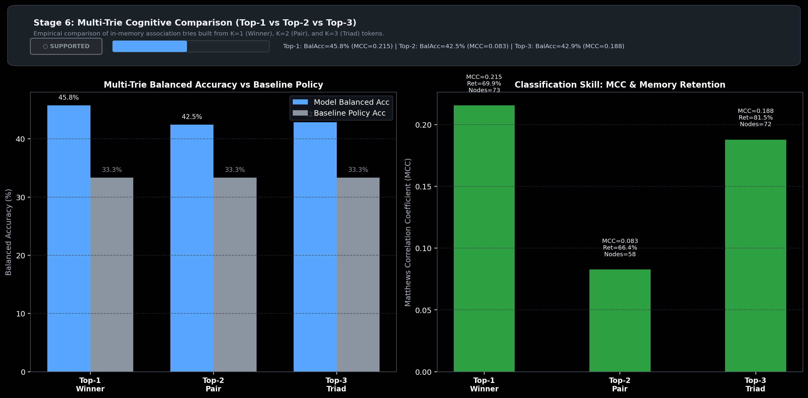

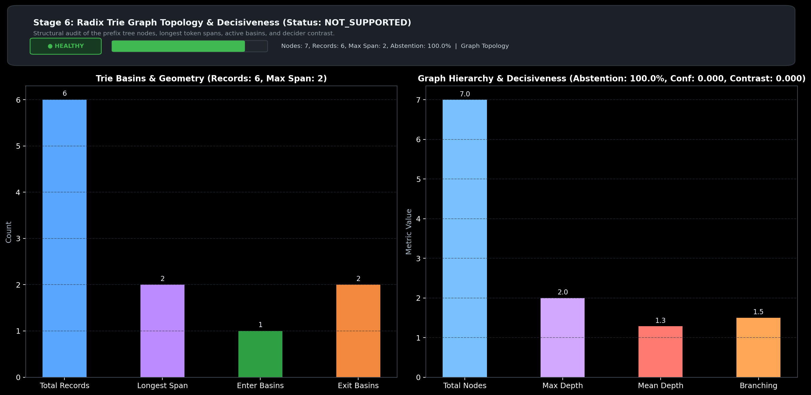

### Validation 1: Production-vs-Audit Equivalence

- Replayed ticks: `10886`
- Tokens verified: `10843`
- Token mismatches: `0`
- Metric/brightness mismatches: `0`
- Executable path: `/var/folders/30/bdbpd0hj5wddgkxyx8pbc0mc0000gn/T/go-build1050214386/b001/exe/main`
- Verdict: `NOT_A_TEST` (one code path compared with itself)

### Validation 2: Metric Truthfulness

- Measurements audited: `10886`
- Physical invariant violations: `0`
- Same-time ambiguous trades skipped: `4499`
- Comparisons per check: `map[cvd_coverage:6387 flow_aligned_midpoint_return:6113 level3_replay:4000760 midpoint_log_return:6113 signed_net_fraction_bounded:20404 trade_book:10777 trade_fields:10886]`
- Violations per check: `map[]`
- Unexercised checks: `[]`
- Verdict: `VALID`

### Validation 3: Causality & State Isolation

- Future perturbation ticks: `54430`
- Lookahead leakage detected: `false` (compared: `182562`, contaminated: `0`)
- Cross-symbol contamination: `false`
- Epoch isolation passed: `true`
- Verdict: `VALID`

### Validation 4: Grid Dependence & Sensitivity

- Families evaluated (LOFO): `10`
- Duplication resistant: `true`
- Verdict: `SUPPORTED`

  - Family `correlation`: Removed JSD = `0.033` bits (dominant: `false`)
  - Family `cvd`: Removed JSD = `0.035` bits (dominant: `false`)
  - Family `depthflow`: Removed JSD = `0.020` bits (dominant: `false`)
  - Family `hawkes`: Removed JSD = `0.012` bits (dominant: `false`)
  - Family `leadlag`: Removed JSD = `0.077` bits (dominant: `false`)
  - Family `liquidity`: Removed JSD = `0.002` bits (dominant: `false`)
  - Family `morphology`: Removed JSD = `0.043` bits (dominant: `false`)
  - Family `pumpdump`: Removed JSD = `0.034` bits (dominant: `false`)
  - Family `sentiment`: Removed JSD = `0.000` bits (dominant: `false`)
  - Family `toxicity`: Removed JSD = `0.006` bits (dominant: `false`)

