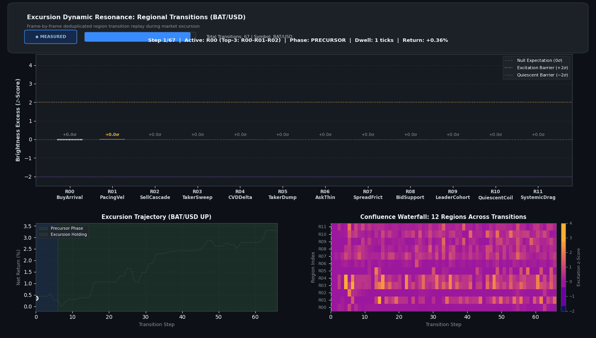
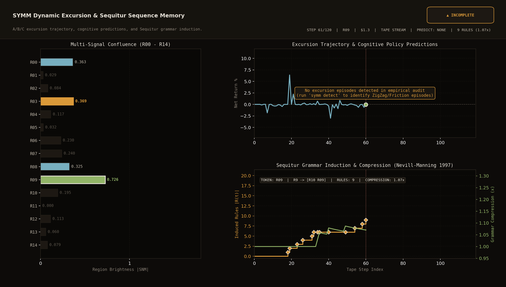
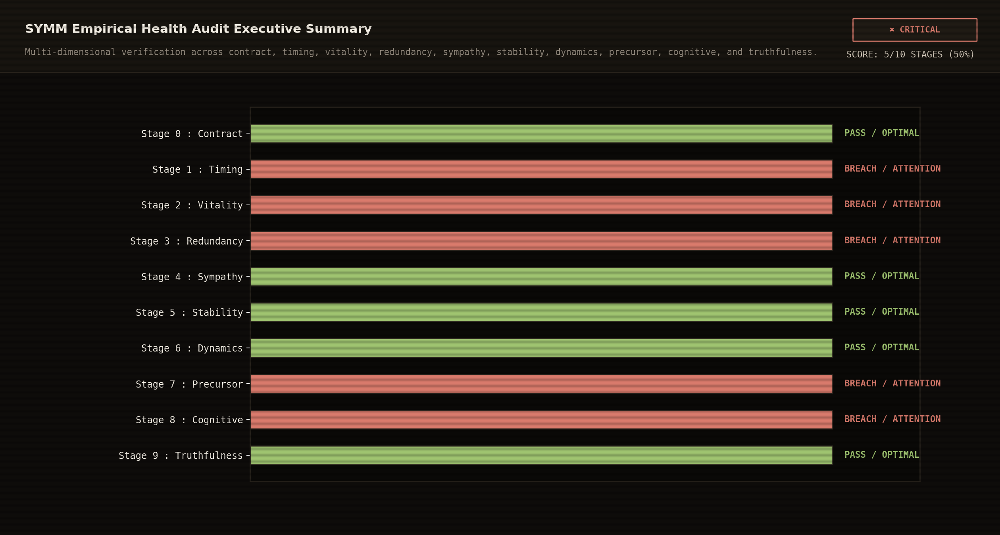

# Audit of epoch 1792223133597007000 (workspace/tick/aggregate/1792223133597007000/)

No policy epoch is trained on these ticks.

| stage | result |
|---|---|
| timing | FAIL |
| contract | pass |
| vitality | FAIL |
| redundancy | FAIL |
| sympathy | pass |
| stability | pass |
| dynamics | pass |
| precursor | FAIL |
| cognitive | FAIL |
| truthfulness | pass |
| realization | FAIL |

## audit:timing

- [VIOLATION] timing.latency_excess,
  **SYMBOL:** AKE/USD,
  **DESCRIPTION:** Delay on AKE/USD is unsteady: 5.4% of 37 packets were far from its usual delay, above the 5% allowance,
  **METRIC:** ,

- [VIOLATION] timing.latency_excess,
  **SYMBOL:** DOT/USD,
  **DESCRIPTION:** Delay on DOT/USD is unsteady: 5.3% of 38 packets were far from its usual delay, above the 5% allowance,
  **METRIC:** ,

- [VIOLATION] timing.latency_excess,
  **SYMBOL:** HYPE/USD,
  **DESCRIPTION:** Delay on HYPE/USD is unsteady: 5.7% of 35 packets were far from its usual delay, above the 5% allowance,
  **METRIC:** ,

- [VIOLATION] timing.latency_excess,
  **SYMBOL:** INJ/USD,
  **DESCRIPTION:** Delay on INJ/USD is unsteady: 16.0% of 25 packets were far from its usual delay, above the 5% allowance,
  **METRIC:** ,

- [VIOLATION] timing.latency_excess,
  **SYMBOL:** RSR/USD,
  **DESCRIPTION:** Delay on RSR/USD is unsteady: 5.5% of 55 packets were far from its usual delay, above the 5% allowance,
  **METRIC:** ,

## audit:contract

## audit:vitality

- [VIOLATION] vitality.unmeasured,
  **SYMBOL:** sentiment.historical_path_distance,
  **DESCRIPTION:** sentiment.historical_path_distance was 0 on every sample from the active symbols (WINGS/USD, Q/USD, RSC/USD, ICNT/USD, RAD/USD), so it never measured anything there,
  **METRIC:** ,

- [VIOLATION] vitality.unmeasured,
  **SYMBOL:** sentiment.historical_path_percentile,
  **DESCRIPTION:** sentiment.historical_path_percentile was 0 on every sample from the active symbols (WINGS/USD, Q/USD, RSC/USD, ICNT/USD, RAD/USD), so it never measured anything there,
  **METRIC:** ,

## audit:redundancy

- [VIOLATION] redundancy.collinear_pair,
  **SYMBOL:** concentration:ask &lt;-&gt; entropy:ask,
  **DESCRIPTION:** Metric pair [concentration:ask &lt;-&gt; entropy:ask] are collinear clones (|r| = -0.9571 &gt;= 0.95 across 2619 observations),
  **METRIC:** ,

- [VIOLATION] redundancy.collinear_pair,
  **SYMBOL:** concentration:bid &lt;-&gt; entropy:bid,
  **DESCRIPTION:** Metric pair [concentration:bid &lt;-&gt; entropy:bid] are collinear clones (|r| = -0.9539 &gt;= 0.95 across 2619 observations),
  **METRIC:** ,

## audit:sympathy

## audit:stability

## audit:dynamics

## audit:precursor

- [VIOLATION] precursor.insufficient_evidence,
  **SYMBOL:** precursor,
  **DESCRIPTION:** 0 precursor and 2211 background tokens over 0 episodes; need 10 of each,
  **METRIC:** ,

- [VIOLATION] excursion.insufficient_evidence,
  **SYMBOL:** excursion,
  **DESCRIPTION:** no up excursions among 0 detected episodes: run detect on the epoch,
  **METRIC:** ,

## audit:cognitive

- [VIOLATION] cognitive.insufficient_evidence,
  **SYMBOL:** cognitive,
  **DESCRIPTION:** no published policies for the epoch: run train on it,
  **METRIC:** ,

## audit:truthfulness

## audit:realization

paper records 0 (0 under other policy epochs), traded paths 0, correlation 0.0000 (p 0.0000), sign agreement 0.000, mean realized - predicted 0.000000

- [VIOLATION] realization.insufficient_evidence,
  **SYMBOL:** realization,
  **DESCRIPTION:** no paper data: no paper/ records were found (run make run with a model, then make paper),
  **METRIC:** ,

## Visualizations & Excursion Dynamics

